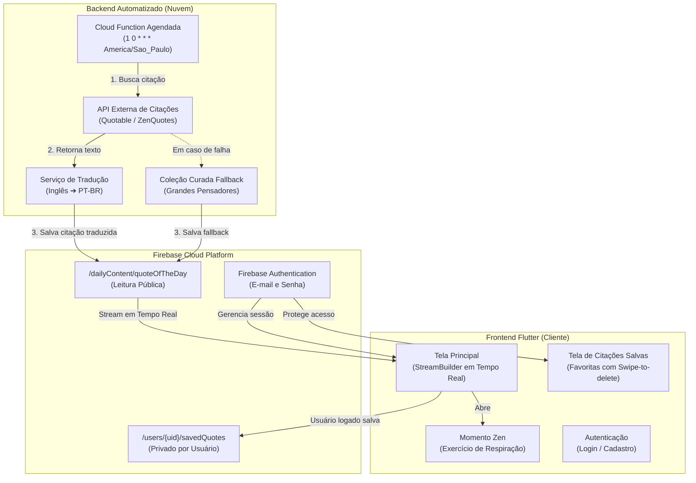

# ZenMind - QuoteGenius 🧘✨

> **Situação de Aprendizagem 5 — Avaliação Somativa Final**  
> Aplicativo Full-Stack de Bem-Estar e Mindfulness desenvolvido com **Flutter** e **Firebase**.

---

## 📋 Sumário
- [Visão Geral do Projeto](#-visão-geral-do-projeto)
- [Arquitetura da Solução](#-arquitetura-da-solução)
- [Modelagem de Dados (Cloud Firestore)](#-modelagem-de-dados-cloud-firestore)
- [Regras de Segurança](#-regras-de-segurança-firestorerules)
- [Cloud Functions e Integração com APIs](#-cloud-functions-e-integração-com-apis)
- [Frontend e Experiência do Usuário (UX)](#-frontend-e-experiência-do-usuário-ux)
- [Guia de Instalação e Execução](#-guia-de-instalação-e-execução)
- [Simulação e Testes de Backend](#-simulação-e-testes-de-backend)
- [Atendimento aos Critérios de Avaliação](#-atendimento-aos-critérios-de-avaliação)

---

## 🌟 Visão Geral do Projeto

O **ZenMind** é uma solução móvel de bem-estar criada com o objetivo de entregar diariamente aos usuários uma dose de sabedoria, serenidade e inspiração. 

O foco central deste projeto é a **automação completa de backend** e a **entrega de dados em tempo real**:
1. Em vez de uma lista estática de frases no código do aplicativo, um serviço em nuvem busca diariamente uma citação de uma **API externa** e salva no banco de dados.
2. O aplicativo Flutter utiliza **Streams reativas (`StreamBuilder`)** para ouvir o documento no Cloud Firestore, atualizando a interface dos usuários em tempo real sem necessidade de recarregar a tela.
3. O aplicativo foi desenhado **com foco total no cliente final**: interface limpa, sem termos técnicos ou configurações visíveis para o usuário comum, proporcionando uma experiência imersiva de tranquilidade.

---

## 🏗️ Arquitetura da Solução



---

## 🗄️ Modelagem de Dados (Cloud Firestore)

A modelagem de dados foi estruturada de forma lógica, eficiente e com separação estrita de escopo público e privado:

### 1. Documento Público: `/dailyContent/quoteOfTheDay`
Contém a citação ativa do dia, acessível por qualquer usuário do app sem necessidade de autenticação.

```json
{
  "text": "A mente que se abre a uma nova ideia jamais voltará ao seu tamanho original.",
  "author": "Albert Einstein",
  "updatedAt": "2026-10-27T14:35:20.000Z",
  "source": "zenquotes.io (PT-BR)"
}
```

### 2. Subcoleção Privada: `/users/{userId}/savedQuotes/{quoteId}`
Armazena o acervo de citações favoritas de cada usuário autenticado.

```json
{
  "text": "A paz vem de dentro. Não a procure à sua volta.",
  "author": "Buda",
  "savedAt": "2026-10-27T14:00:00.000Z"
}
```

---

## 🛡️ Regras de Segurança (`firestore.rules`)

As regras garantem integridade total: clientes mobile têm apenas permissão de **leitura** na citação do dia (a escrita é restrita a processos de backend/Admin), enquanto as citações pessoais só podem ser lidas e manipuladas pelo próprio autor logado:

```javascript
rules_version = '2';

service cloud.firestore {
  match /databases/{database}/documents {

    // 1. Citação do Dia: Qualquer visitante pode ler; apenas Admin/Backend grava
    match /dailyContent/{document} {
      allow read: if true;
      allow write: if false;
    }

    // 2. Citações Salvas: Restrito ao próprio usuário autenticado
    match /users/{userId}/savedQuotes/{quoteId} {
      allow read, write, delete: if request.auth != null && request.auth.uid == userId;
    }
  }
}
```

---

## ⚡ Cloud Functions e Integração com APIs

Localizadas no diretório `functions/`:

- **Função Agendada (`updateQuoteOfTheDay`)**:
  - Configurada via `firebase-functions/v2/scheduler` para disparar diariamente às `00:01` (`America/Sao_Paulo`).
  - Chamada HTTP resiliente com timeout configurado.
  - **Tradução Automática para Português (PT-BR)**: As APIs internacionais retornam o conteúdo em inglês. O pipeline traduz automaticamente a frase para português antes de persistir no banco.
  - **Estratégia de Alta Disponibilidade (Fallback)**:
    1. Tenta API Primária: `Quotable API`.
    2. Tenta API Secundária: `ZenQuotes API`.
    3. Em caso de indisponibilidade de rede/API externa, utiliza uma lista curada em português com grandes pensadores (Buda, Clarice Lispector, Sócrates, Einstein, Marco Aurélio, Dalai Lama).

- **Função HTTP (`updateQuoteManual`)**:
  - Endpoint de teste que permite executar sob demanda a rotina de atualização.

---

## 🎨 Frontend e Experiência do Usuário (UX)

O aplicativo foi desenvolvido com arquitetura limpa em camadas:
- `lib/models/`: Modelos de dados imutáveis com deserialização segura (`Quote`, `SavedQuote`).
- `lib/services/`: Camada de serviços (`AuthService`, `FirestoreService`).
- `lib/widgets/`: Componentes visuais desacoplados (`QuoteCard` com efeito frosted glass, `GradientBackground`).
- `lib/screens/`: Telas da aplicação (`HomeScreen`, `LoginScreen`, `RegisterScreen`, `SavedQuotesScreen`).

### 📱 Experiência Focada no Cliente Final:
- **Design Zen:** Paleta com gradiente roxo profundo (`#1A0533` a `#0D1B6E`), tipografia elegante com `Playfair Display` para frases e `Lato` para leitura limpa.
- **Microanimações:** Círculos translúcidos animados flutuando suavemente ao fundo.
- **Acesso Descomplicado:** Qualquer pessoa abre o app e recebe a frase do dia sem barreiras de cadastro.
- **Momento Zen:** Modal interativo guiando um breve exercício de respiração consciente (4 segundos inspirando, 2 segurando, expirando suavemente).
- **Ações Rápidas:** Botão de cópia para a área de transferência com feedback visual e botão flutuante para salvar nos favoritos.
- **Minhas Citações:** Listagem das frases preferidas do usuário com suporte a deslizar para excluir (*Swipe-to-delete* com confirmação).

---

## 🚀 Guia de Instalação e Execução

### Pré-requisitos
- Flutter SDK (versão 3.x ou superior)
- Dart SDK
- Node.js (versão 20 ou superior)
- Emulador Android ou aparelho físico conectado com depuração USB

### 1. Clonar e Instalar Dependências do App
```bash
# Na raiz do projeto:
flutter pub get
```

### 2. Executar o Aplicativo
```bash
flutter run
```

---

## 🧪 Simulação e Testes de Backend

Para validar a atualização em tempo real sem depender de horário ou de planos pagos na nuvem, foi incluído um executor dedicado de teste:

```bash
# Executa a busca em API externa, traduz para PT-BR e atualiza o Firestore ao vivo:
npm run update-quote
# ou:
node simulate_cloud_function.js
```

### Como testar a sincronização em tempo real:
1. Deixe o app aberto no emulador/celular.
2. Em um terminal, execute `npm run update-quote`.
3. Observe a tela do aplicativo: **a citação muda instantaneamente na tela** graças ao `StreamBuilder` conectado ao Firestore!

---

## 📊 Atendimento aos Critérios de Avaliação

| Critério de Avaliação | Como foi implementado |
|---|---|
| **Cloud Function Agendada** | Implementada em `functions/index.js` com cron `1 0 * * *`, tratamento com `try/catch` e fallback resiliente. |
| **Consumo de API Externa** | Integração com Quotable e ZenQuotes com tradução automática para PT-BR. |
| **Banco de Dados Cloud Firestore** | Coleções `/dailyContent` e `/users/{uid}/savedQuotes` estruturadas e normalizadas. |
| **Sincronização em Tempo Real** | `StreamBuilder` reativo na `HomeScreen` ouvindo as alterações sem recarregar. |
| **Segurança e Privacidade** | `firestore.rules` publicado com leitura pública apenas na citação diária e isolamento total por usuário nas citações salvas. |
| **Autenticação de Usuários** | Firebase Authentication com fluxo completo de cadastro, login e persistência de sessão. |
| **Qualidade de Código e Arquitetura** | Separação estrita de camadas (UI, Models, Services, Widgets). Sem erros no `flutter analyze`. |
| **Experiência do Usuário (UX)** | Design elegante de bem-estar, feedback visual (*SnackBars*, diálogos de confirmação), efeito *frosted glass* e zero poluição técnica para o cliente. |
